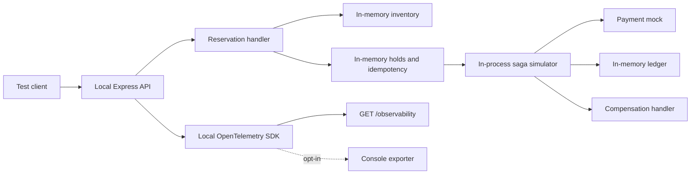
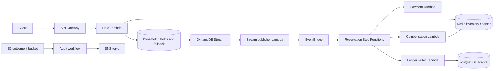

# ED-DRLE — Event-Driven Distributed Reservation & Ledger Engine

ED-DRLE is a TypeScript backend project for studying inventory reservations,
idempotency, saga orchestration, compensation, resilience, and observability.
It contains AWS CDK infrastructure declarations and a local Express simulator.

> **Project status:** This repository is a learning and development project,
> not a production-ready service. The standard test suite uses in-memory
> adapters and an in-process saga simulator. The AWS infrastructure has not
> been deployed or verified end to end. See [Known limitations](#known-limitations)
> before relying on any behavior in a real environment.

## Contents

- [Capabilities](#capabilities)
- [Architecture](#architecture)
- [Technology](#technology)
- [Getting started](#getting-started)
- [Local API](#local-api)
- [Configuration](#configuration)
- [Testing and benchmarks](#testing-and-benchmarks)
- [Repository layout](#repository-layout)
- [Deployment and security status](#deployment-and-security-status)
- [Known limitations](#known-limitations)
- [Project documentation](#project-documentation)

## Capabilities

- Reservation holds with a `PENDING` lifecycle and asynchronous local saga
  simulation.
- Token-bucket request limiting for clients that provide a client ID.
- Payload-bound idempotency in the memory adapter.
- Redis inventory adapter with DynamoDB fallback adapter in the application
  code.
- Compensation, expiry reconciliation, and bounded Redis inventory-key
  retention controls.
- Shared downstream retry, timeout, jitter, and optional in-process load
  shedding policy.
- PostgreSQL ledger adapter using a process-local `pg.Pool`.
- Local audit reconciliation flow with a human-review queue.
- Local RED metrics, trace spans, W3C `traceparent` extraction, and optional
  OpenTelemetry console exporters.
- AWS CDK declarations for API Gateway, Lambda, DynamoDB, EventBridge,
  Step Functions, S3, SNS, SQS, CloudWatch alarms, and a dashboard.

The presence of an adapter or infrastructure declaration does not mean that
the corresponding live service path has been tested. The local and AWS paths
are described separately below.

## Architecture

### Local path used by the normal test suite



The ordinary `npm test` command sets `LOCAL_TESTING=true`. Its repository
registry selects memory implementations, and its saga runs in-process. It
does not connect to Redis, PostgreSQL, DynamoDB Local, LocalStack, or AWS.

### AWS resources declared by CDK



This diagram represents resources declared in CDK, not a verified deployment.
The checked-in CDK API exposes `POST /reserve`; the additional routes listed
under [Local API](#local-api) exist only in the Express simulator. The cloud
Step Functions input contract also has a known mismatch recorded in the
[architecture audit](docs/as-is-architecture.md#request-and-event-paths).

## Technology

| Area | Technology in the repository |
|---|---|
| Application | TypeScript, Node.js |
| Infrastructure as code | AWS CDK v2 |
| Local HTTP emulator | Express |
| Primary inventory adapter | Redis (`ioredis`) |
| Fallback and hold adapters | DynamoDB AWS SDK |
| Ledger adapter | PostgreSQL (`pg.Pool`) |
| Local test adapters | In-memory repositories |
| Observability | OpenTelemetry API, Node trace SDK, metrics SDK |
| Optional local services | Redis 7, PostgreSQL 16, LocalStack via Docker Compose |

CDK declares the Node.js 20 Lambda runtime. Local development has been
validated with Node.js 22.17.1. The OpenTelemetry SDK dependencies require a
supported modern Node.js runtime; use Node.js 20.6 or later.

## Getting started

### Prerequisites

- Node.js 20.6 or later and npm.
- Git.
- Optional: Docker Compose for the Redis, PostgreSQL, and LocalStack service
  declarations. These services are **not** required by the standard test
  suite.

### Install and verify

From the repository root:

```sh
npm ci
npm run build
npm test
npm run test:phase6
```

`npm test` starts the in-process API test server on port `3000`, runs the local
verification pipelines, and exits with a non-zero status if a pipeline fails.
`npm run test:phase6` runs focused observability, trace-propagation, injected
failure, bounded-snapshot, and export tests. To run only the
console-exporter check, use `npm run test:otel`.

### Start the local HTTP simulator manually

The server uses the configured repository registry. Set
`LOCAL_TESTING=true` to select the memory adapters; do not start it against
default real-service adapters unless those services and their data are
intentionally configured.

PowerShell:

```powershell
$env:LOCAL_TESTING = "true"
npx ts-node src/local/local-server.ts
```

macOS/Linux:

```sh
LOCAL_TESTING=true npx ts-node src/local/local-server.ts
```

The default listening port is `3000`; override it with `PORT`.

The included [Docker Compose file](docker-compose.yml) declares Redis,
PostgreSQL, and LocalStack for optional local experimentation. The regular test
suite does not use them, and this repository does not provide a verified
end-to-end Compose bootstrap for every table, workflow, and service.

## Local API

The following routes are implemented by the local Express simulator. They
should not be treated as a deployed or secured production API.

| Method and path | Purpose |
|---|---|
| `POST /reserve` | Create a reservation hold. Requires an `Idempotency-Key` header and JSON `EventID` and `UserID`; optional `HoldID`. |
| `GET /observability` | Return the local RED snapshot and retained finished spans; flushes configured telemetry exporters first. |
| `GET /inventory/:eventId` | Read current primary and fallback inventory values. |
| `POST /inventory/seed` | Seed inventory for local tests. JSON: `{"eventId":"event-1","count":10}`. |
| `POST /chaos/redis/toggle` | Toggle simulated Redis unavailability when using the memory adapter. |
| `POST /audit/upload` | Submit an array of settlement records to the local audit flow. |
| `GET /audit/pending` | List in-memory human-review items. |
| `POST /audit/approve` | Approve a pending local review; JSON requires `reviewId`, optional `ledgerReservationId`. |
| `GET /ledger` | List transactions from the configured ledger repository. |

Example reservation:

```sh
curl -i http://localhost:3000/reserve \
  -H "Content-Type: application/json" \
  -H "Idempotency-Key: demo-reservation-001" \
  -H "X-Client-Id: demo-client" \
  -d '{"EventID":"event-1","UserID":"user-1","HoldID":"hold-001"}'
```

The handler can return `202 Accepted` for a created hold, `400 Bad Request` for
invalid input, `409 Conflict` for out-of-stock or an existing hold,
`429 Too Many Requests` when the token bucket is depleted, or a server error
when a dependency fails. The local simulator launches its saga asynchronously
after an accepted reservation; inspect local state and logs rather than
assuming the saga has finished when the HTTP response arrives.

PowerShell equivalent:

```powershell
$headers = @{
  "Idempotency-Key" = "demo-reservation-001"
  "X-Client-Id" = "demo-client"
}
$body = @{
  EventID = "event-1"
  UserID = "user-1"
  HoldID = "hold-001"
} | ConvertTo-Json

Invoke-RestMethod -Method Post `
  -Uri "http://localhost:3000/reserve" `
  -ContentType "application/json" `
  -Headers $headers `
  -Body $body
```

The rate limiter is process-local and is applied only when a client ID is
provided. Requests without that header bypass it; local tests intentionally
use this behavior, but it is not evidence of production ingress protection.

## Configuration

The application reads configuration from environment variables. The defaults
below are development-oriented and are not production credentials or
deployment recommendations.

| Variable | Default | Used for |
|---|---|---|
| `LOCAL_TESTING` | unset / `false` | Set to `true` to use in-memory repositories. `npm test` sets this itself. |
| `PORT` | `3000` | Local Express listener. |
| `REDIS_HOST` | `localhost` | Redis inventory adapter host. |
| `REDIS_PORT` | `6379` | Redis inventory adapter port. |
| `REDIS_INVENTORY_TTL_SECONDS` | `86400` | TTL assigned when setting an inventory key. |
| `DB_HOST` | `localhost` | PostgreSQL host. |
| `DB_PORT` | `5432` | PostgreSQL port. |
| `DB_NAME` | `ledger_db` | PostgreSQL database name. |
| `DB_USER` | `postgres` | PostgreSQL user. |
| `DB_PASSWORD` | `postgres` | PostgreSQL password; replace for any non-disposable environment. |
| `DB_POOL_MAX` | `10` | Maximum connections in this Node process's PostgreSQL pool. |
| `DB_IDLE_TIMEOUT_MS` | `30000` | PostgreSQL idle connection timeout. |
| `DB_CONNECTION_TIMEOUT_MS` | `5000` | PostgreSQL connection timeout. |
| `PAYMENT_TIMEOUT_MS` | `500` | Payment mock per-attempt timeout. |
| `PAYMENT_MAX_ATTEMPTS` | `3` | Maximum payment attempts. |
| `PAYMENT_BACKOFF_BASE_MS` | `25` | Payment retry backoff base. |
| `PAYMENT_BACKOFF_MAX_MS` | `250` | Maximum payment retry backoff. |
| `OTEL_CONSOLE_EXPORTER` | `false` | Set to `true` to enable diagnostic console trace and metric exporters. |
| `AUDIT_MODE` | `mock` | Audit reasoner mode. |
| `AWS_ENDPOINT_URL` | `http://localhost:4566` | AWS SDK endpoint override used by local AWS adapter code. |
| `AWS_DEFAULT_REGION` | `us-east-1` | AWS SDK region. |

Additional AWS workflow variables, including `EVENT_BUS_NAME`,
`AUDIT_STATE_MACHINE_ARN`, and `SNS_TOPIC_ARN`, are set or defaulted in source.
Do not commit credentials or secrets. No `.env.example` is currently provided;
configure environment variables in your shell or a secret manager, and keep
local secret files untracked.

## Testing and benchmarks

### Test coverage

The regular suite exercises local/in-memory scenarios including:

- Concurrent reservations against limited stock.
- Idempotency behavior.
- Simulated primary inventory outage and fallback behavior.
- Saga compensation on injected payment failure.
- Audit review and approval.
- Token-bucket rate limiting.
- Structured logs and correlation IDs across asynchronous local saga work.
- A transient local load exercise.

Focused Phase 6 checks additionally verify bounded local snapshots, trace
parent-child relationships, W3C context extraction, injected failure spans,
and console exporter output.

### Performance results

Committed benchmark scripts and raw output live in [`bench/`](bench/). The
committed baseline is a **local-in-memory** run of 500 requests in sequential
batches of 50, with the local rate limiter bypassed:

| Measurement | Recorded value |
|---|---:|
| Throughput | 357.91 requests/second |
| p50 latency | 112 ms |
| p95 latency | 201 ms |
| p99 latency | 213 ms |
| Successful responses | 500 / 500 |

This is not an AWS, Redis, PostgreSQL, or DynamoDB benchmark. The later
commit-qualified run does not demonstrate a controlled performance gain; see
the [benchmark report](docs/benchmark-report.md) and its linked raw results.
The 10,000 RPS figure is an unverified target, not a measured capability.
Do not use the transient load output printed by `npm test` as benchmark
evidence; it is not saved with the `/bench` provenance format.

## Repository layout

```text
bench/       Reproducible local load scripts and raw benchmark results
db-init/     PostgreSQL schema initialization for the optional Compose service
docs/        Architecture, design decisions, evidence, and limitations
infra/       AWS CDK application and stack declarations
src/
  handlers/  Reservation, payment, ledger, compensation, and audit handlers
  local/     Express server and in-process saga simulator
  repository/ Storage interfaces and memory, Redis, DynamoDB, PostgreSQL adapters
  utils/     Idempotency, rate limiting, resilience, logging, and telemetry
tests/       Local verification and phase-specific tests
```

## Deployment and security status

This repository does not currently have a verified production deployment
procedure. The CDK stack is source code only and should not be deployed as-is:
it uses local endpoints and sample database credentials in Lambda environment
configuration, includes destructive resource-removal settings, and has known
workflow-contract issues. The stack also does not provision RDS or RDS Proxy.

The local Express simulator has administrative/testing routes and no
authentication. Bind and expose it only in a controlled development
environment. Replace sample credentials, review IAM and network boundaries,
resolve the documented workflow issues, and validate resource lifecycle and
cost before any cloud deployment. No AWS resources were created or tested as
part of the documented local verification.

## Known limitations

- DynamoDB idempotency acquire/complete operations are unimplemented; the
  payload-bound implementation is tested only with the memory adapter.
- Compensation replay is guarded in the local path, but hold-state persistence
  and inventory return are not crash-atomic across stores.
- Expiry reconciliation is not a durable Redis/DynamoDB consistency protocol.
  The Redis TTL bounds key retention but is not synchronized to hold lifecycle.
- Fault injection is a deterministic in-memory model, not live network, Redis,
  DynamoDB, PostgreSQL, or AWS fault injection.
- The payment timeout races the operation but does not cancel underlying work;
  load shedding is process-local.
- The PostgreSQL pool is per process. No RDS or RDS Proxy is provisioned.
- The AWS Step Functions saga input contract needs correction and cloud
  validation.
- OpenTelemetry console export is local and opt-in. No remote collector, AWS
  export, deployed dashboard, alert delivery, or multi-instance propagation
  has been verified.
- The 10,000 RPS target is unverified.
- `npm audit --omit=dev` reported four production dependency advisories at the
  time of the audit. Review the current audit output before deployment; no
  automatic dependency upgrades were applied.

## Project documentation

- [Current design and evidence boundaries](docs/v2-design.md)
- [v1 as-is architecture audit](docs/as-is-architecture.md)
- [v1-to-v2 comparison](docs/v1-v2-comparison.md)
- [Benchmark report and raw result links](docs/benchmark-report.md)
- [Phase 1 lifecycle model](docs/phase1-low-level-design.md)
- [Phase 2 correctness work](docs/phase2-correctness.md)
- [Phase 3 fault-injection model](docs/phase3-fault-injection.md)
- [Phase 4 performance analysis](docs/phase4-performance.md)
- [Phase 5 network resilience](docs/phase5-network-resilience.md)
- [Phase 6 observability](docs/phase6-observability.md)
- [Decisions](docs/decisions.md)
- [Failures and unresolved evidence](docs/failures.md)
- [Resume worksheet—verified claims only](docs/resume-worksheet.md)
