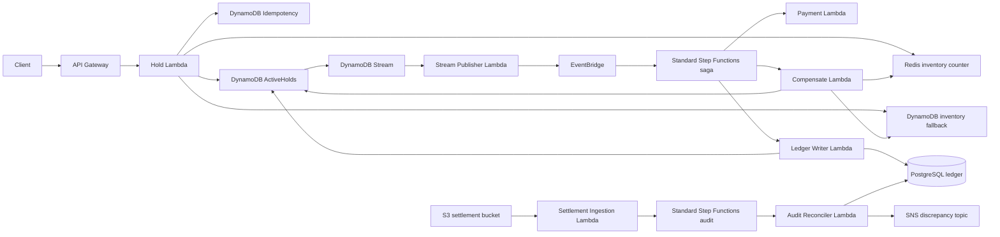

# ED-DRLE v1 As-Is Architecture

Audit date: 2026-11-24
Audited commit: `1b2ba0305b0a63e63e0dc4fab40e4628f1af77ec`
Repository state: `main`, clean at audit start; no `v1.0` tag exists.

This document describes what is present in the repository, not a claim that the
AWS deployment has been run or that the README's performance figures have been
reproduced.

## Stack verified from code

- Application language: TypeScript (`package.json` uses TypeScript 5.5).
- Local development runtime: Node.js; the audit host reports Node `v22.17.1`.
- Lambda runtime declared by CDK: Node.js 20.
- Infrastructure as code: AWS CDK v2, implemented in TypeScript.
- Local services declared by Compose: Redis 7, PostgreSQL 16, and LocalStack.
- AWS SDK clients: DynamoDB, EventBridge, S3, Secrets Manager, Step Functions,
  and SNS.
- Storage implementations: Redis inventory, DynamoDB inventory fallback and
  holds, PostgreSQL ledger, and in-memory test adapters.

The test runner sets `LOCAL_TESTING=true` and selects in-memory inventory,
hold, ledger, and idempotency repositories. The local Express server and
`StepFunctionsSimulator` are used for tests; those tests do not exercise Redis,
PostgreSQL, DynamoDB Local, LocalStack, API Gateway, or AWS Step Functions.

## Request and event paths

The synchronous reserve path checks a token-bucket limiter, performs an
idempotency lookup/write, decrements Redis (or falls back to DynamoDB), then
creates a conditional `PENDING` hold with a 10-minute expiration timestamp. A
DynamoDB stream publishes hold events to EventBridge, which starts a Standard
Step Functions saga. The saga invokes payment and then either ledger writing or
compensation.

The audit path ingests settlement objects from S3 and uses a separate Standard
Step Functions workflow. CDK also defines an EventBridge reconciliation rule
with a five-minute interval, but its event payload is hard-coded to
`evt_concert_seat_1` and capacity `100`.

The CDK API Gateway exposes only `POST /reserve`. The local Express emulator
also has `/audit/upload`, `/audit/pending`, and `/audit/approve` routes; they are
not wired into API Gateway by the checked-in stack.

There is also a cloud/local saga contract mismatch to investigate before
relying on the AWS workflow. The stream publisher emits `HoldID` in EventBridge
detail, while the payment handler expects a top-level `ReservationID`. The CDK
target has no explicit detail-to-input mapping. In addition, the payment task's
`outputPath: "$.Payload"` replaces the state with the payment response, so the
ledger and compensation tasks do not receive the original reservation fields
their handlers require. The local simulator passes those fields directly and
therefore does not verify this CDK workflow contract.

The local simulator is a separate execution path: Express calls the hold
handler and starts the in-process saga simulator; tests use memory repositories.
The Compose file declares real local services, but the normal `npm test` path
does not select them.

## Storage, expiry, and connection handling

- DynamoDB `ActiveHolds` has a TTL attribute `ExpirationTimestamp`; hold states
  in the interface are `PENDING`, `SETTLED`, and `CANCELLED`.
- DynamoDB `Idempotency` has TTL attribute `expirationTime`.
- `reconcileEvent` counts every `PENDING` and `SETTLED` hold without checking
  `ExpirationTimestamp`; there is no `EXPIRED` hold state.
- Redis inventory keys use `inventory:<EventID>`. `setStock` issues `SET`
  without an expiry, and the repository has no key-retention/eviction policy.
- `PostgresLedgerRepository` is in `src/repository/ledger.postgres.ts` and uses
  the `pg` package's `Pool` for SQL queries. This is client-side pooling within
  each Node process; it is not an RDS Proxy.
- `docker-compose.yml` declares a local PostgreSQL container. The CDK stack
  does not declare an RDS database or an RDS Proxy. Its Lambda environment
  points `DB_HOST` at `host.docker.internal`, so the checked-in stack describes
  a local-container database endpoint, not a deployed RDS endpoint.
- `tests/run-tests.ts` sets `LOCAL_TESTING=true`, selecting `MemoryLedgerRepository`;
  the default test suite does not connect to the Compose PostgreSQL service.

Therefore, “no connection pooling” is not accurate for the checked-in code:
`pg.Pool` exists. “No RDS Proxy” is accurate, but there is also no RDS instance
defined in this CDK stack. A proxy decision depends on first defining a real
AWS RDS/Aurora deployment and measuring connection pressure.

## Gap evidence from source inspection

| Claimed gap | What the repository currently does |
|---|---|
| Compensation is not idempotent | The compensation handler reads a hold, conditionally changes its versioned status to `CANCELLED`, then increments inventory on every invocation. It does not gate the increment on a successful first transition. |
| No expiry reconciliation | Hold expiration is set and DynamoDB TTL is enabled, but reconciliation counts expired `PENDING` holds as active; no explicit expiry transition or bounded reconciliation window is implemented. |
| Redis state unbounded | Redis inventory keys are written without TTL and no repository cleanup is defined. |
| No RDS Proxy / pooling | `pg.Pool` is present; no RDS or RDS Proxy resource is defined. This claim needs correction rather than an invented failing test for absent client pooling. |

These are source-inspection findings, not yet test-run reproductions. Phase 0's
failing reproductions and benchmark execution are recorded separately below.

## Load-test evidence and 10,000 RPS target

The existing `tests/load.test.ts` issues 500 requests in sequential batches of
50 against the local in-memory Express server. It bypasses rate limiting when
no client ID is provided in local-test mode, and it writes an ignored
`test-results/metrics.json` file without date, commit hash, or environment
metadata.

The README claims `229.67 RPS` and `p95 315 ms`, while the checked-in ignored
`test-results/metrics.json` currently contains `600.2400960384153` throughput
and `p95 131 ms`. Neither has verifiable run provenance. A committed
`/bench/v1-load.ts` run recorded in
[`bench/results/v1-load-2026-11-24T10-56-43-480Z.json`](../bench/results/v1-load-2026-11-24T10-56-43-480Z.json)
measured the local in-memory scenario at `357.91 RPS`, with `p50 112 ms`,
`p95 201 ms`, `p99 213 ms`, and 500/500 HTTP 202 responses. Its recorded script
commit is `8a06cbe3907434eaf1228a08ed74112c0a0fb742`; the run is dated
`2026-11-24T10:56:43.480Z` UTC. This is a local simulator measurement, not an
AWS result. The repository does not contain the stated 10,000 RPS target.

By arithmetic, the 10,000 RPS target is about `27.94x` the recorded
`357.91 RPS` local baseline. This is a target-to-local-test comparison, not a
measured AWS capacity gap; it is not safe to extrapolate from the in-memory,
500-request test to a cloud system.

At 10,000 *unique successful* reservations per second, the code path implies at
least:

- 10,000 hold requests and 10,000 Redis inventory operations per second;
- 10,000 idempotency reads, 20,000 idempotency writes, and 10,000 hold writes
  per second (about 40,000 logical DynamoDB operations before saga updates);
- up to 10,000 asynchronous saga starts per second, plus payment, ledger, or
  compensation work.

These are operation-count estimates from the current success path, not AWS
capacity estimates: item sizes, consistency, retry/duplicate rates, Lambda
concurrency, database connection limits, service quotas, Redis topology, and
resource sizing are not established by this repository. No cloud capacity
claim can be made from the available test evidence.

## Audit limits and next evidence

- No AWS resources were created or queried.
- Docker is not available on the audit host, so Compose-backed local services
  could not be exercised.
- No production application source or infrastructure was changed during this
  audit.
- Docker is unavailable, so the benchmark uses the in-memory adapters and
  bypasses the rate limiter, just as the existing v1 test does.
- The committed local measurement is stored in `/bench/results` with date,
  script commit, environment, status counts, and raw latency samples.
- No benchmark has exercised AWS or the Compose services.
