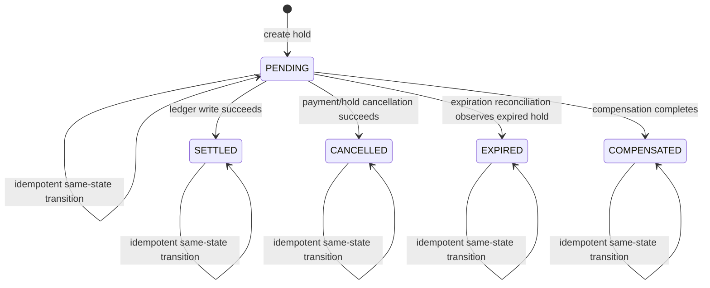
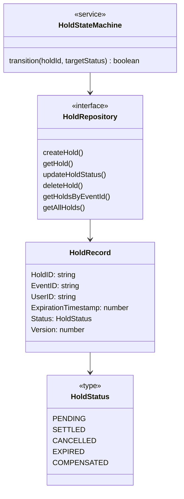

# Phase 1 Low-Level Design

Audit commit for the lifecycle model: this document is for the `v2` branch.

## Reservation lifecycle

`PENDING` is the only non-terminal state. `SETTLED`, `CANCELLED`, `EXPIRED`,
and `COMPENSATED` are terminal in the lifecycle model. Same-state transitions
are no-ops for retries.

The state machine is intentionally not yet called by the hold, ledger, or
compensation handlers. Phase 1 defines and tests the lifecycle contract only.

## Interfaces

`HoldRepository` remains the storage interface. It owns conditional/OCC updates
and is implemented by memory and DynamoDB repositories.
`HoldStateMachine` owns legal transition rules and reads the current record
before issuing a versioned repository update.

## Transition invariants

- A hold cannot move from a terminal state to a different terminal state.
- `PENDING -> PENDING` is an idempotent no-op.
- Terminal -> terminal is allowed only for the same state.
- Any missing hold rejects the transition.
- A version mismatch in the repository must reject a concurrent OCC update.

These rules are proved by the full 5-by-5 transition matrix in
`tests/phase1/hold-state-machine.test.ts`. Missing-hold behavior is also tested.

## Correctness boundaries

The lifecycle model does not yet make compensation or expiry atomic. Adding
`EXPIRED` and `COMPENSATED` changes the type surface, but handlers still use
direct status updates. Phase 2 must add conditional writes and idempotency keys
to make the external side effects agree with these states.
