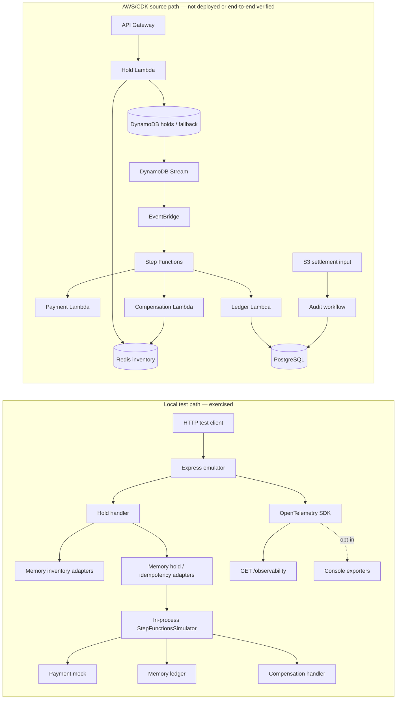

# ED-DRLE v2 Design and Evidence Boundaries

This document describes repository code and local test behavior. The CDK
resources below are source declarations; they have not been deployed or
validated against AWS. The ordinary local suite uses memory adapters.

## Architecture

The local simulator and the declared AWS workflow are distinct paths. The
normal `npm test` command exercises the left side with in-memory repositories;
it does not establish that the right-side workflow works in AWS. In particular,
the v1 audit found an event/state-input mismatch in the CDK saga workflow; see
the [as-is audit](as-is-architecture.md#request-and-event-paths).

## Reservation lifecycle and side effects

The lifecycle vocabulary is `PENDING`, `SETTLED`, `CANCELLED`, `EXPIRED`, and
`COMPENSATED`. The transition matrix is documented in the
[Phase 1 design](phase1-low-level-design.md).

The modeled reserve flow is:

1. Apply the local token-bucket limiter when a client ID is supplied.
2. Acquire/replay an idempotency record, binding a key to its request payload.
3. Decrement primary inventory, or use fallback inventory on primary-store
   failure.
4. Create a `PENDING` hold with an expiration timestamp.
5. In the local simulator, launch the saga asynchronously. Payment success
   leads to ledger writing and settlement; payment failure leads to
   compensation.

Idempotency and repositories are not equally implemented across adapters.
Payload-bound acquire/complete behavior is covered in memory; the DynamoDB
implementation remains a TODO. Compensation uses a state transition to avoid
repeating the inventory return in the memory path. A crash between persisting
the hold transition and returning inventory is not atomic across stores.

Expiry reconciliation transitions expired pending holds before calculating
active stock in the local implementation. This is not a defined, durable
Redis/DynamoDB consistency window. Redis inventory keys use a configurable TTL
(`REDIS_INVENTORY_TTL_SECONDS`, default 86,400 seconds), which bounds key
retention but does not synchronize key expiry with hold lifecycle.

## Resilience and persistence

The payment mock uses bounded retries, capped exponential full jitter, a
timeout, and the existing circuit breaker. The timeout uses `Promise.race`;
it does not cancel the underlying work. The local concurrency shedder is
process-scoped, not distributed.

The PostgreSQL repository uses `pg.Pool`, configured with process-local
connection bounds and timeouts. The repository's CDK stack does not define an
RDS instance or RDS Proxy. No live PostgreSQL or Redis test was run as part of
the local suite.

The seeded fault harness and verified behaviors are summarized in
[Phase 3](phase3-fault-injection.md) and
[Phase 5](phase5-network-resilience.md). Those results model failures in
memory; they are not network fault-injection or AWS evidence.

## Observability

The local server extracts W3C `traceparent` and keeps the existing correlation
ID as `eddrle.correlation_id`. Manual spans connect reserve, saga, payment
attempts, ledger writes, and compensation. RED counters and a duration
histogram are exported to console only when `OTEL_CONSOLE_EXPORTER=true`.
`GET /observability` returns local snapshots and flushes telemetry.

Finished spans and duration samples are bounded to 2,048 retained entries per
process; request/error counts are cumulative, while duration statistics
describe the recent retained window. The
[Phase 6 report](phase6-observability.md) records the exporter tests and
remaining limits. There is no remote collector, AWS metric/trace export, or
live dashboard/alert verification.

## Performance evidence

Only the committed scripts and raw outputs under [`/bench`](../bench/) are
benchmark evidence. Their workload is local, in-memory, and rate-limit
bypassed. The benchmark report explains why those results do not prove an
AWS capacity target or a controlled optimization gain:
[benchmark report](benchmark-report.md).
